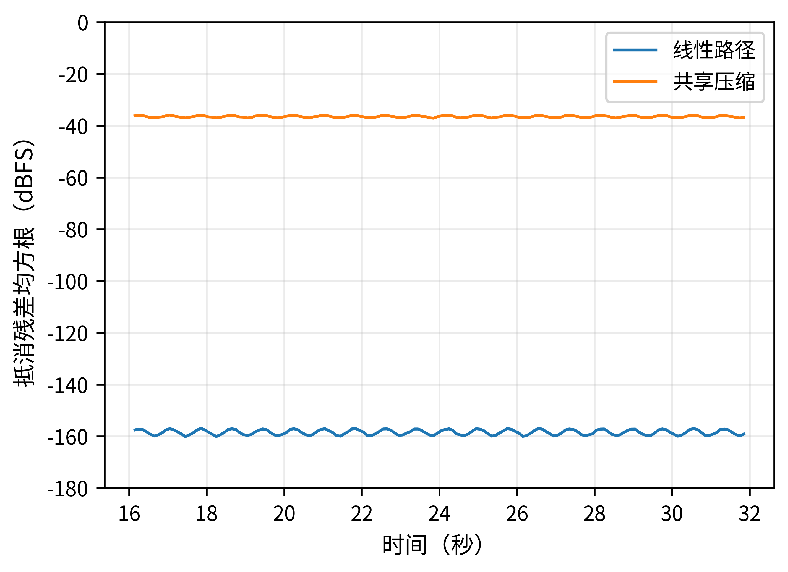

# S1　合成信号与总线压缩核验

对应论文：**《人工智能混音局部编辑的音乐关系约束研究》**（v1.9工作稿）。

本页由v1.8正式补充材料S1迁移，保留信号构造、处理参数和参考结果。“共享压缩”是旧代码及记录中的名称，在本例指两条信号先相加，再由同一总线压缩器处理。它不表示两个独立轨道压缩器。

本页的表格为历史参考记录；本次打包复算见[复算说明](reproduction_check.md)。这些材料只核验规定信号下的比例关系与压缩影响，不代表REAPER实机运行、完整AI模型复现或人耳实验。

## S1.1　输入和实现

采样率48,000 Hz，时长36秒，t=n/48000，n=0,…,1,727,999。以下幅度均为满幅值1下的线性幅度。信号先按双精度生成，再转成32位浮点进入音频处理。

第一条信号：e(t)=0.45+0.45 sin²(2π×0.63t)；v(t)=e(t)[0.24 sin(2π×233t)+0.08 sin(2π×466t)+0.03 sin(2π×699t)]。左右声道均为v(t)。

第二条信号：a(t)=0.16 sin(2π×73.416t)+0.055 sin(2π×146.832t)+0.07 exp[−((t mod 0.5)/0.06)] sin(2π×55t)+0.005z[n]。z由NumPy default_rng(20261013)的标准正态序列获得，默认位生成器为PCG64。左声道为a(t)，右声道为0.95a(t)+0.015 sin(2π×440t)。不作归一化。

包络q(t)在16秒前与32秒后为0，在16—16.05秒线性升至1，16.05—31.95秒为1，再于31.95—32秒降至0。脚本按线性幅度交叉插值施加Gain组件：A=v+[Gain(+1.5 dB)(v)−v]q+a；B=v+a+[Gain(−1.5 dB)(a)−a]q。恒定段的比例式不依赖过渡段采用线性幅度还是分贝插值，但完整渲染必须记录实际插值方式。

压缩支路分别对A、B全长信号调用新建的Pedalboard Compressor，阈值−18 dB、压缩比4、启动10 ms、释放100 ms，reset=True。不分块重置状态。该组件不是ReaComp的等价实现。

A、B及压缩输出均保存为32位浮点WAV后重新读入，再用Gain(+1.5 dB)补偿B并与A相减。残差计算区间为16.05≤t<31.95秒，统计两个声道全部样本的双精度均方根；dBFS=20log10(RMS)，基准为1。图6显示内部完整100 ms块的曲线，不显示跨越包络边界的块；整段统计仍按上述精确区间计算。

| 检查项 | 历史参考记录（v1.8） |
| --- | --- |
| Python／平台 | 3.13.5／Linux x86_64 |
| NumPy／SoundFile／Pedalboard | 2.3.5／0.13.1／0.9.23 |
| 线性路径残差RMS | −158.3273889178004 dBFS |
| 共享压缩路径残差RMS | −36.468766863449716 dBFS |
| 线性残差峰值 | 8.940696716308594×10⁻⁸ |
| 共享压缩残差峰值 | 0.03667527437210083 |

## S1.2　复现与文件核对

在独立Python环境中安装code/requirements.txt，再执行：python code/run_dsp_example.py --out output。输出包括完整音频、20—22秒试听片段、results.json及100 ms残差表。压缩器版本或数值后端改变可能造成不同的浮点舍入，跨平台核验应先比较数值差异和设置，不能只按文件容器哈希判断音频是否一致。

records/reference/component_results.json保存v1.8历史参考运行的完整版本信息、数值与SHA-256；程序中的两项断言只检查线性残差是否足够小、压缩残差是否明显不同，不是可闻性或音乐质量判据。信号属于合成诊断材料，不标为录制的人声、贝斯或歌曲。

论文中的REAPER段落是按官方功能设计的操作路径，原材料记录未执行该宿主；本次打包也未执行该宿主，也没有生成其GUI实测截图。使用REAPER核验时，冻结采样率、路由、声像、插件顺序及版本；关闭分轨推子前渲染以测量推子后输出；记录包络缩放及插值、预运行起点、延迟补偿和尾音。共享非线性处理必须由全体声部共同进入后再取总输出。

## 对应图与音频

图像直接取自当前论文，未重绘；图中旧称“共享压缩”对应本页所述的总线压缩。六个合成诊断片段见[音频目录](../audio_excerpts/)。这些片段不是录制的人声、贝斯或歌曲。
