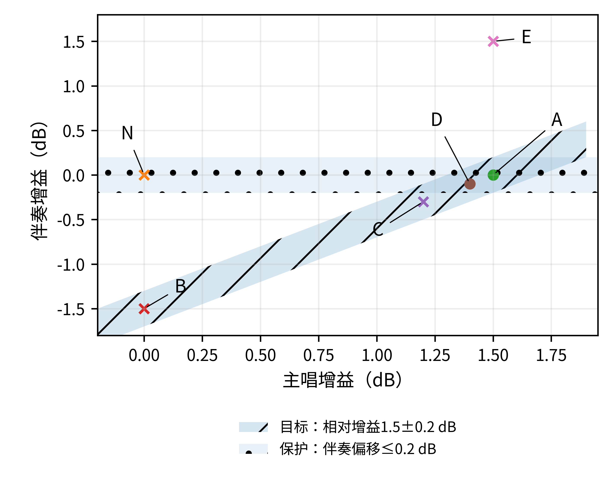

# S2　验证协议与候选比较

对应论文：**《人工智能混音局部编辑的音乐关系约束研究》**（v1.9工作稿）。

本页由v1.8正式补充材料S2迁移，并补入当前主稿表6，使读者能够在仓库中直接查看评分锚点。协议的数值条件和研究状态保留。候选计算与评分规则有可运行的示例程序；**实际作品的听觉实验及样本量功效计算尚未开展**。本页是研究协议，不是实验结果，也不是已完成的预注册记录。

[候选与代价定义](#s2-2) · [试听与评分](#s2-4) · [样本规划](#s2-6)

## S2.1　冻结信息与研究层次

正式运行前对每项任务登记：作品ID、母版/派生谱系、素材授权、基准工程哈希、声部ID、区间、前后语境、目标、保护、允许伴随变化、未观察项、权限、插件与版本、候选预算、听评预算及分析版本。修改登记信息后生成新的协议版本，不覆盖已收集条件。

研究分三层：数值执行测试检验参数与可测变化；共同候选池实验检验选择准则；工作流扩展检验开发试听参与后实际交付的效果。只有后两层包含独立的音乐听觉判断，数值执行测试不用于证明语义控制。

| 层次 | 候选与反馈 | 主要解释范围 |
| --- | --- | --- |
| 数值执行 | 固定工程、预设目标、全部记录；无听者。 | 线性条件与执行正确性。 |
| 共同池主实验 | 固定候选池和四个机器选择器，首选输出冻结。 | 指定池内关系筛选和代价的影响。 |
| 完整流程扩展 | 各组按同样规则最多试听三个候选；开发反馈与正式听者分离。 | 有限人机流程的交付率、代价与独立接受。 |

## S2.2　候选及观察量

主唱线性池用两轨各−1.5、−1.0、−0.5、0、0.5、1.0、1.5 dB的49种组合，加(1.2,−0.3)与(1.4,−0.1)两项，共51项。默认顺序按主唱增益、伴奏增益升序排列并赋固定ID；基础选择器用种子20261015对全部ID打乱，再取第一个达到共同目标的方案。零目标和反向测试仍使用同一池。

仅在两轨均非静音且无共享处理的规定窗口计算r_T=20log10(RMS主唱/RMS伴奏)。目标偏差为|Δr_T−g|，g为任务目标；保护距离为|ΔL伴奏|。未达到有效能量门槛的窗口标记缺失，不补极小数强行形成关系值。门槛必须在任务登记中依据文件精度、静音检测及有效内容确定并冻结。

低频池先由制作人在基准材料确定一个频带，登记中心频率、带宽、滤波器类型/相位模式及选频依据，再冻结。单轨增益取−1.5、−0.75、0、0.75、1.5 dB，单轨钟形均衡衰减取0、−1.5、−3 dB，按允许轨道的笛卡尔积产生候选并去重；组合上限在登记中明确。贝斯持续音窗口在基准中标注，避开素材静音，以轨道处理后RMS相对基准的绝对变化≤0.5 dB为本示例的可测保护项。目标击点辨识及贝斯音高、持续性等仍按独立试听判定。

> 迁移说明：原v1.8文档写作“带宽Q”。本页根据当前v1.9主稿改为“带宽”，实施时仍须登记实际使用的带宽表示方式与单位；未在此次迁移中替作者确定滤波器参数。原文保存在作者本地资料中。

四种选择器分别为：G内固定随机顺序、G内最小C_o、F_m内最小D_P、F_m内最小J；G仅使用共同权限、技术验收和可测目标，不提前使用待检验保护容差。同分按ID。此处仅操作代价C_o在原始脚本中取0.2C_S+0.2C_θ，沿用该演算的固定权重。没有可测目标的任务不使用E_T筛选；没有任何可测保护项时，机器关系筛选对照不适用，改用有明确人工保护判定的工作流扩展，不能把两组相同操作解释为关系控制无效。

主唱例D_P=|ΔL伴奏|/0.2；C_S=发生非零修改的包络数/2；C_θ=(|Δg主唱|+|Δg伴奏|)/1.5，J=0.6D_P+0.2C_S+0.2C_θ。这一定义固定两轨工程表示，不允许临时通过新增总线减少包络数。多个可测保护量以预先固定、和为1的α_j汇总D_P=Σα_j d_j/ε_j；ε_j=0的项只作硬性检查。

一般任务的C_S以授权对象的“实际非零操作持续时长之和／授权对象总时长”计算；同轨多个参数在该项只取时间并集。C_θ以预先列出的参数尺度s_k>0归一化后汇总|Δθ_k|/s_k，时间变化参数以授权时段上的平均绝对变化计算。新建效果器记其结构操作与参数初值；这些口径必须在组间保持一致，并另列原始轨道数、参数数及渲染数。不同口径不能混作同一代价。

A与D例展示分量支配：D在保护偏移和操作范围上更大，参数代价相同；只要相应权重中至少一项为正，A优于D。该例不是权重最优性的实验。code/candidate_protocol.py实际检查51项、负向/零/正向目标、绝对保护距离和判定规则，结果保存于records/reference/analytical_candidates.json；所有数值均为条件计算。

## S2.3　材料、听者与试次

材料按作品划分预实验、开发选择与正式评价，源音轨和派生混音保持同一分组。主唱任务有完整声部语境；低频任务含共同发声和持续音；跨段落任务包含过渡。正式听者不参与该轮候选调参或选择。参加前说明任务并取得知情同意，以匿名编号保存记录，允许随时退出；身份联系方式与评分分开保存。专业听者、一般音乐听者分别登记经验和任务辨识，不以是否认同某方法作为筛选标准。

练习至少包含一组目标不足、一组适度、一组过度和一组保护受损的独立示例。听者能复述目标和保护项、理解量表方向后开始正式评价；练习不要求赞同制作人的审美，只确认任务理解。未完成练习、音频播放中断或明确未按流程完成的记录，按预先登记的规则处理；保留原始记录与排除理由。

每试次为基准加四个匿名候选，同一播放位置同步切换；最多六个任务组成一个区组，每20分钟休息，完整设计至少含两个不相邻重复任务。先听语境、再听目标区间、再回听前后段落；目标和保护评分先于整体接受。采用平衡次序或在每个作品层面随机分配，避免每组总在固定按钮位置。

## S2.4　评分、接受与缺失

目标−3至3的方向表示相对于要求的不足或过度，不代表输出越高分越好；主目标通过为−1至1。多个目标分别评分并要求同时通过。保护0至6逐项评分，每项≤2；整体接受为是/否；技术验收必须通过。总体质量0—100为辅助，不可抵消任一失败项。下表按当前论文表6列出评分锚点。

| 评价对象 | 等级说明（评分锚点） | 本设计的接受条件 |
| --- | --- | --- |
| 目标偏差（−3至3） | −3明显反向／远未达到；−2不足；−1略不足；0适度；1略过；2过度；3严重过度。 | −1至1；数值目标另检查技术容差。 |
| 每项保护损失（0至6） | 0未察觉损失；1可察觉但不影响功能；2轻微且可接受；3临界、需再改；4明显；5严重；6关系受破坏。 | 每一指定保护项均不高于2。 |
| 整体接受 | 是否接受此版本完成当前任务：是／否；另记录否定理由。 | “是”，且技术验收通过。 |
| 总体质量（辅助） | 0—100连续评分，五个等分区间对应差、较差、一般、良好、优秀。 | 独立报告，不抵消目标或保护失败。 |

听者层面联合通过Y=1，当且仅当所有目标适度、所有指定保护项≤2、整体接受为是且技术合格。任务级辅助标签要求有效判断≥预定人数的80%，其中通过比例≥2/3；否则分别标为证据不足或未接受。报告分子分母和区间，不只报告一个标签。无法判断、播放失败和方案未生成分开存储；未生成方案计入该任务交付失败；在预先分配的任务—方法—听者组合中，系统联合通过记为0，而听觉属性分数保持缺失。这是技术未通过的系统结局，不伪造音频或听者评分。

无法判断在评分模型中保留为缺失，并提供全部缺失按通过/不通过两种极端界限；听者层面模型报告其缺失假定。重复试次用于一致性，正式效应分析只保留首次呈现或按预注册方式加入重复指标，不当作独立作品。操作代价以任务—方法为单位统计，不按听者复制样本。

## S2.5　条件操纵与连续任务

数值目标采用−1.5、−1.0、−0.5、0、0.5、1.0、1.5 dB；语言任务使用经独立材料校准的“略／适中／较明显”及方向改述，不预设与这些分贝逐一对应。选择性只检查事先指定的保护对象，未建模内容另行说明。

同义表达、无关附加信息、相反要求、多目标组合和连续顺序分别作为情境。相同种子配对仅在随机调用结构相同时使用；更换模型结构或调用顺序时独立重复。所有条件采用相同候选与渲染预算，保留完整候选，不只展示最好版本。

连续编辑保留初始基准s_0、上一版本s_(k−1)和本轮s_k。本轮目标相对上一版本检查，持续保护相对登记的初始或阶段锚点检查。若新的目标取消旧保护，应生成任务授权的新版本。预算耗尽只说明本轮未找到方案；只有矛盾被逻辑证明或完整枚举授权离散域，才报告对应域内不可行。

## S2.6　样本规划与统计分析

规划输入必须来自独立预实验或明确的保守假设：各条件联合通过基线、最低有用差异、作品/听者/任务的变异、随机斜率、每名听者分配的任务数与缺失率。可把联合通过率相差0.10作为待论证的规划假设，但必须说明制作意义并在正式数据出现前冻结；不得称其为预期的已知效果。

| 作品数 | 听者数 | 规划要求 |
| --- | --- | --- |
| 12 | 24 | 使用同一假定与分配；模拟功效及区间精度。 |
| 12 | 36 | 使用同一假定与分配；模拟功效及区间精度。 |
| 12 | 48 | 使用同一假定与分配；模拟功效及区间精度。 |
| 18 | 24 | 使用同一假定与分配；模拟功效及区间精度。 |
| 18 | 36 | 使用同一假定与分配；模拟功效及区间精度。 |
| 18 | 48 | 使用同一假定与分配；模拟功效及区间精度。 |
| 24 | 24 | 使用同一假定与分配；模拟功效及区间精度。 |
| 24 | 36 | 使用同一假定与分配；模拟功效及区间精度。 |
| 24 | 48 | 使用同一假定与分配；模拟功效及区间精度。 |

每个规模至少模拟1000次，目标功效0.80，家族错误率0.05；同时检验缺失和随机效应较大的敏感性情景。优先保证作品覆盖，再依据每人最长试听负担选择平衡不完全区组；每个任务至少由12名有效听者评价是此规划的分配下限，不是已被证明足够的样本量。功效不够时增加作品/听者或改为精度导向的可行性研究，不降低主要差异要求换取显著性。

联合通过用二项混合模型：关系保护因素、操作代价因素及其交互为固定项，作品、作品内任务及听者为随机项；若数据可识别，增加条件随机斜率。听者经验作为预设分层或固定因素，而非依据不显著后才合并。模型不收敛先检查编码和数值缩放，再取消相关随机斜率的相关参数，最后按预注册顺序简化斜率；随机截距和失败说明保留。

主要检验家族包括：仅关系保护相对基础条件的保护通过率与联合通过率；完整选择相对仅关系保护的联合通过率与操作代价。四个预定比较采用Holm校正，报告效应量和区间。操作代价比较同时呈现失败率、纳入任务比例和全部任务的计算资源，不让较多失败的方法仅凭便宜而获优势。

目标绝对偏差等级与保护损失采用有序模型，目标正负符号另报告以识别不足和过度。连续关系偏移使用适合分布的连续混合模型；对预先设定的等效范围报告对应区间与判断。两单侧等效检验在α=0.05时对应90%区间，而非一般地以“95%跨零”认定保持。保护单侧非劣效、双侧等效和差异检验分别解释。

本仓库没有听者数据，因而不报告任何模拟功效数值、受试者规模完成情况或显著性。S2规定实施时需要冻结的参数、运行次序与统计规则；规划中的待估变异来自预实验，不由本文的合成信号结果替代。

## S2.7　文件与开放材料

仓库代码仅依赖公开音频组件或Python标准库，未包含商业插件、受版权限制的歌曲分轨或字体。正式研究开放素材时另核授权，不能把原始歌曲随实验脚本自动公开。代码和结果记录应与协议版本对应保存，公开素材另按其授权范围提供。

## 对应的候选示意图

图像保留原论文的数值和标记；目标容差与保护容差是本例的设计条件，并非通用听觉阈限。
